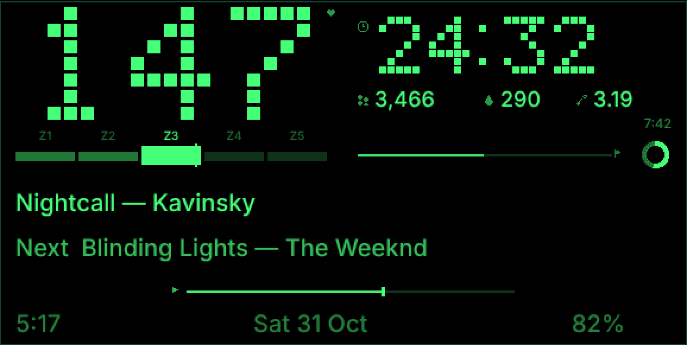

# Bio HUD for Even G2

Your Apple Watch workout on the glasses, with your own Spotify playlists.

One tap on the Watch: the playlist you picked starts on your phone, and the lens
shows live heart rate with a zone bar, the timer, steps, calories, distance, now
playing and next track. The lens sleeps after 15 seconds and wakes on a temple
tap, a look‑up, a zone change, or workout start and end. Runs with the phone
locked when installed as an Even Hub beta build.



```
 Apple Watch  ──HR, steps, kcal, distance, start/end──►  Cloudflare Worker  ◄──poll──  Even G2 (Even Hub app)
                                                           │  ▲
                                             Spotify Web API  Open‑Meteo weather  optional glucose URL
```

## What you need
- Even G2 glasses and the Even app with Developer Mode (sign in once at hub.evenrealities.com).
- Apple Watch and a Mac with Xcode, to build the Watch app for yourself.
- Spotify Premium and a Spotify developer app (free, 2 minutes).
- A free Cloudflare account. One user fits comfortably in the free tier.

## Setup
```bash
git clone https://github.com/amirhayeri/even-realities.git && cd even-realities
./setup.sh
```
The script asks a few questions, creates the Worker, generates your token and
writes the three config files. It ends with the four manual steps: Spotify
redirect URI, glasses beta release, Watch build, first run. Everything secret
stays in git‑ignored files.

## Repo
Office HUD, the morning briefing, is its own product and repo: https://github.com/amirhayeri/office-hud

| Folder | What |
|---|---|
| `app/` | Even Hub app (TypeScript, Even Hub SDK). `npm run dev` previews the lens in a browser with a mock session. `npm run release` ships a beta. |
| `endpoint/` | Cloudflare Worker: workout state, health ingest, Spotify, weather, glucose. |
| `watch/` | watchOS app: owns the HKWorkoutSession, playlist picker, streams to the Worker. |
| `docs/` | Even Hub reference compiled from the SDK, design canvas notes, the Even Terminal runbook. |

## Hard‑won notes
- `createStartUpPageContainer` returns `invalid` for any page unless text containers are SDK class instances with `borderWidth`, `borderColor`, `borderRadius` and `paddingLength` all set.
- The Even app's WebView drops the `Authorization` header on cross‑origin requests. The token travels as `?token=` as well.
- The firmware wraps space‑padded "right aligned" lines. Use separate containers per column.
- Sleep by rebuilding the page with one blank container, not by blanking each container; otherwise elements vanish one by one.
- Tailscale on the Mac or phone breaks Xcode's Watch pairing. Off while installing.
- Health Auto Export or the Shortcuts "when workout starts" automation are alternatives to the Watch app; the Watch app makes both unnecessary.
- The Even Hub CLI login expires often; `npx evenhub login` before a release.

## Status and disclaimer
Personal project, MIT licensed, used daily by its author. Not a medical device.
The optional glucose display reads whatever URL you configure and is off by
default. Issues and pull requests welcome.
